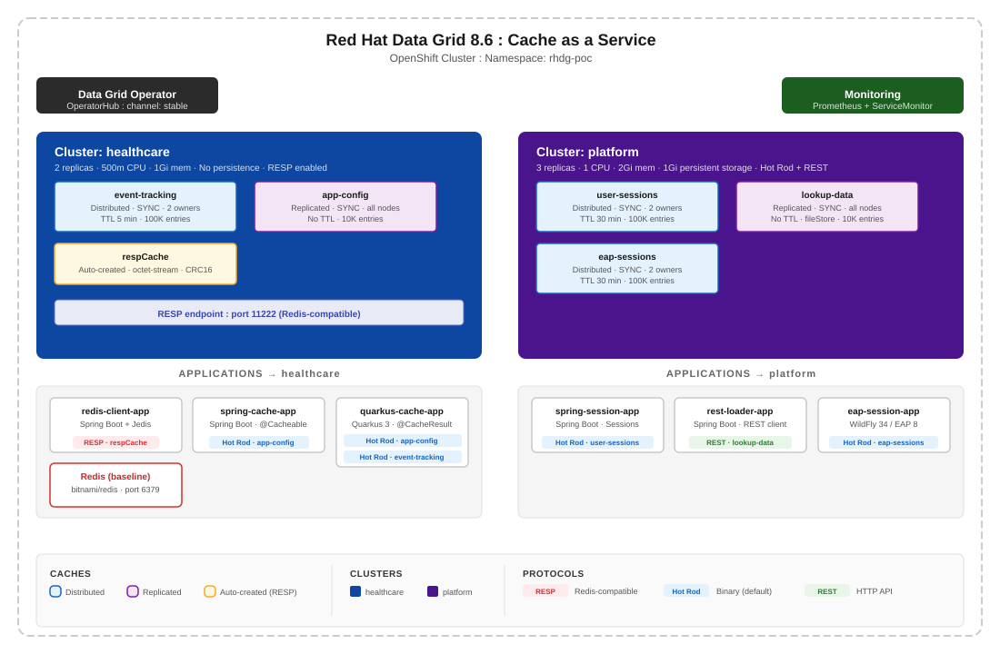

# Red Hat Data Grid: RESP Protocol Transparency Demo

Demonstrates that existing Redis applications work with **Red Hat Data Grid 8.6** without code changes, using the RESP (Redis Serialization Protocol) endpoint.

Data Grid is included in the **Red Hat Application Foundations** subscription - no additional license is required.



## What This Demo Proves

1. **RESP Transparency** - A Spring Boot app using Jedis switches from Redis to Data Grid by changing only environment variables. Zero code changes.
2. **Pub/Sub Across Frameworks** - Two apps (Spring Boot + Quarkus) exchange real-time events via Data Grid Pub/Sub, both using standard Redis clients.
3. **Cross-Language Compatibility** - A .NET app using StackExchange.Redis connects to the same Data Grid cluster via RESP.
4. **Operations Visibility** - The Data Grid Console provides cache monitoring, cluster health, and entry inspection.
5. **Performance Under Load** - Gatling load tests validate throughput and latency against Data Grid's RESP endpoint.

## Applications

| App | Framework | Client Library | Runs on | Purpose |
|-----|-----------|---------------|---------|---------|
| [redis-client-app](apps/redis-client-app/) | Spring Boot 3 (Java 21) | Jedis 8.0 | OpenShift | Web UI for cache operations + real-time Pub/Sub event log via SSE |
| [external-cache-client](apps/external-cache-client/) | Quarkus 3 (Java 21) | Jedis 8.0 | Local | Connects to Data Grid RESP from outside OpenShift. Subscribes to Pub/Sub events |
| [dotnet-hash-test](apps/dotnet-hash-test/) | ASP.NET Core (.NET 10) | StackExchange.Redis 3.2 | Local | Redis Hash operations with cache-aside pattern. Target for Gatling |
| [gatling-load-test](apps/gatling-load-test/) | Gatling 3.15 (Java 21) | HTTP | Local | Load test against dotnet-hash-test API |

## Prerequisites

- OpenShift 4.x cluster with admin access
- `oc` CLI authenticated to the cluster
- `jq` installed
- cert-manager Operator installed on the cluster
- Grafana Operator installed on the cluster (optional, for monitoring dashboard)
- Java 21 + Maven
- .NET 10 SDK (optional, for dotnet-hash-test + Gatling)
- Docker or Podman (for building redis-client-app image)

## Environment Setup

Follow these steps to prepare the environment. Once complete, proceed to the [Demo Walkthrough](DEMO.md) to execute the demo.

### 1. Create the namespace

```bash
oc new-project rhdg-poc
```

### 2. Install Data Grid Operator

```bash
oc apply -f manifests/01-operator-group.yaml
oc apply -f manifests/02-operator-subscription.yaml
```

Wait for the Operator to be ready:

```bash
oc get csv -n rhdg-poc | grep datagrid
```

### 3. Set up TLS certificates (cert-manager)

```bash
oc apply -f manifests/04-healthcare-selfsigned-issuer.yaml
oc apply -f manifests/05-healthcare-ca-certificate.yaml
oc apply -f manifests/06-healthcare-ca-issuer.yaml
oc apply -f manifests/07-healthcare-tls-certificate.yaml
```

### 4. Create credentials

Edit `manifests/03-healthcare-credentials.yaml` and replace the placeholder passwords with your own values.

```bash
oc apply -f manifests/03-healthcare-credentials.yaml
```

### 5. Deploy the Data Grid cluster

```bash
oc apply -f manifests/08-cluster-healthcare.yaml
```

Wait for the cluster to form:

```bash
oc wait --for=condition=WellFormed infinispan/healthcare -n rhdg-poc --timeout=300s
```

### 6. Create caches

```bash
oc apply -f manifests/09-cache-event-tracking.yaml
oc apply -f manifests/10-cache-resp.yaml
oc apply -f manifests/11-cache-app-config.yaml
```

### 7. Deploy Redis baseline

Edit `manifests/12-redis-secret.yaml` and replace the placeholder password.

```bash
oc apply -f manifests/12-redis-secret.yaml
oc apply -f manifests/13-redis-deployment.yaml
oc apply -f manifests/14-redis-service.yaml
```

### 8. Build and deploy redis-client-app

Build the container image and push it to any container registry accessible from your OpenShift cluster (e.g. [Quay.io](https://quay.io), Docker Hub, GitHub Container Registry, or your cluster's internal registry). The examples below use [Quay.io](https://quay.io), Red Hat's container registry. The target platform must match your OpenShift cluster node architecture.

If your build machine and OpenShift nodes share the same architecture:

```bash
cd apps/redis-client-app
docker build -t quay.io/<your-namespace>/redis-client-app:latest .
docker push quay.io/<your-namespace>/redis-client-app:latest
```

If they differ (e.g. building on Apple Silicon for amd64 nodes):

```bash
cd apps/redis-client-app
docker buildx build --platform linux/amd64 -t quay.io/<your-namespace>/redis-client-app:latest --push .
```

Edit `manifests/15-redis-client-app-deployment.yaml` and update the image reference and Redis password.

```bash
oc apply -f manifests/15-redis-client-app-deployment.yaml
oc apply -f manifests/16-redis-client-app-service.yaml
oc apply -f manifests/17-redis-client-app-route.yaml
```

### 9. Configure local apps

Before running the demo, configure connection settings for the local apps.

**external-cache-client**: edit `apps/external-cache-client/src/main/resources/application.properties` and set `datagrid.resp.host` to your cluster's RESP route hostname and update the credentials.

**dotnet-hash-test** (optional, needed for Gatling): no file edits needed, all configuration is via environment variables at startup (see [Demo Walkthrough](DEMO.md), Act 4).

### 10. Configure patches

Edit the patch files in `patches/` and replace the placeholder credentials with your actual values:

| Patch | Purpose |
|-------|---------|
| `patches/patch-redis-client-to-redis.yaml` | Point redis-client-app to Redis (baseline) |
| `patches/patch-redis-client-to-datagrid.yaml` | Point redis-client-app to Data Grid (RESP) |

### 11. Deploy Grafana dashboard (optional)

The Grafana dashboard (`manifests/18-grafana-dashboard-datagrid.yaml`) provides real-time Data Grid metrics (cache hit/miss ratios, latency, memory, connections). Requires OpenShift monitoring stack (Prometheus) enabled and Grafana Operator installed.

```bash
oc apply -f manifests/18-grafana-dashboard-datagrid.yaml
```

### Environment is ready

Proceed to the [Demo Walkthrough](DEMO.md).

## Key Architecture Decisions

- **Operator over Helm** - Cache, Batch, Backup/Restore CRDs for declarative cache management
- **Isolated clusters per tenant** - One Operator, multiple Infinispan CRs with independent pods, credentials, and RBAC
- **RESP cache configuration** - `application/octet-stream` key encoding (mandatory) and `RESPHashFunctionPartitioner` (CRC16)
- **Custom TLS via cert-manager** - Self-signed CA chain for internal and external RESP access

## References

- [Red Hat Data Grid 8.6 Documentation](https://docs.redhat.com/en/documentation/red_hat_data_grid/8.6)
- [Data Grid RESP Protocol Guide](https://docs.redhat.com/en/documentation/red_hat_data_grid/8.6/html/using_the_resp_protocol_endpoint_with_data_grid/)
- [Data Grid Operator Guide](https://docs.redhat.com/en/documentation/red_hat_data_grid/8.6/html/data_grid_operator_guide/)

## License

Apache License 2.0 - see [LICENSE](LICENSE).
